# 03-instalacion-proxmox

## Objetivo
El objetivo es instalar Proxmox en una máquina virtual de virtualbox para disponer de un entorno de virtualizacion.
La instlación se realiza en un entorno virtual de pruebas, de esta forma, se puede practicar la administración de sistemas y la configuración de redes virtuales sin modificar el sistema operativo principal del ordenador.

## Procedimiento
Preparación del entorno: se comprueba que VirtualBox está instalado y que el equipo dispone de recursos suficientes para ejecutar la máquina virtual.

Descarga de la ISO: se obtiene la imagen de instalación de Proxmox VE desde su página web oficial.

Creación de la máquina virtual: se crea una nueva máquina virtual en VirtualBox y se asignan los recursos necesarios, como memoria RAM, procesadores y almacenamiento virtual.

Configuración de la ISO: se monta la imagen ISO de Proxmox VE en la unidad óptica virtual para iniciar el instalador.

Inicio de la instalación: se arranca la máquina virtual y se selecciona la opción de instalación de Proxmox VE.

Configuración inicial: se siguen los pasos del instalador, aceptando las condiciones correspondientes y configurando el almacenamiento, la ubicación, la contraseña de administración y los datos de red solicitados.

Finalización: se completa la instalación y se reinicia la máquina virtual, retirando la ISO si fuera necesario para evitar que vuelva a iniciarse el instalador.

Comprobación: se verifica que Proxmox VE arranca correctamente y que es posible acceder a su interfaz de administración web, siempre que la configuración de red lo permita.

## Comandos usados


```bash

hostnamectl
ip -br addr
pveversion
df -h

```

## Evidencias

### Evidencia 0-configuracion-virtualbox
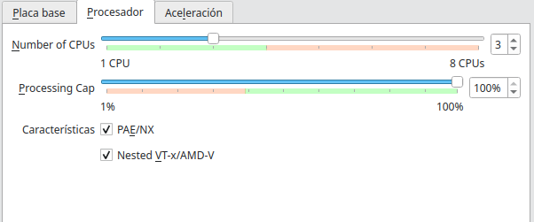
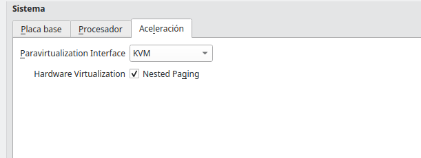
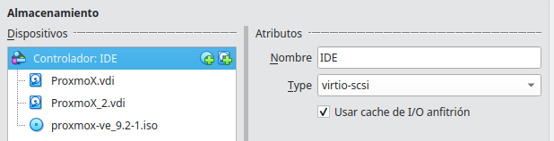

### Evidencia 1-virtualbox
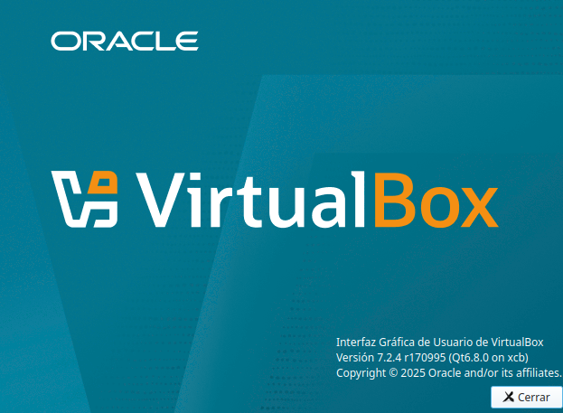
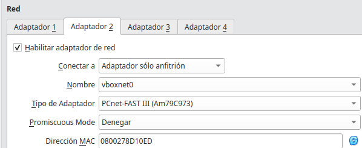
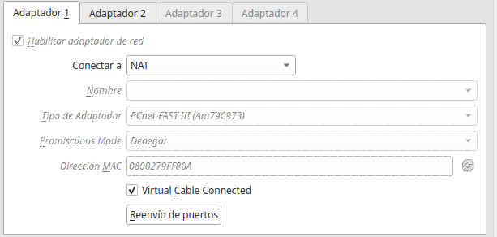
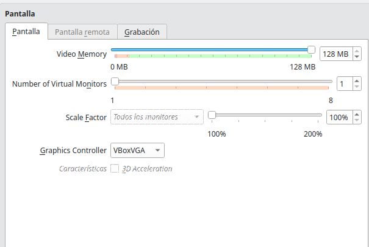
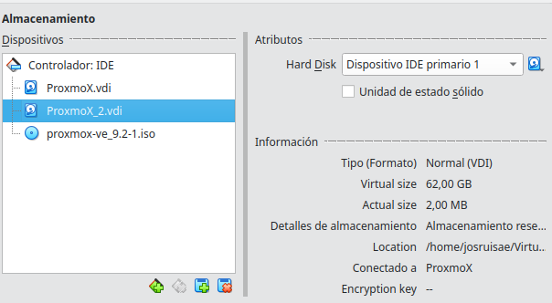
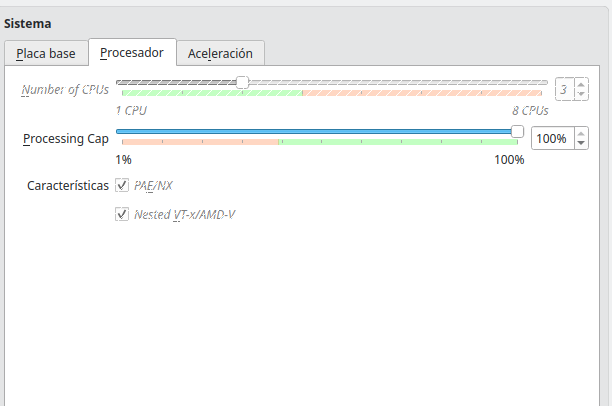

### Evidencia 2-instalador
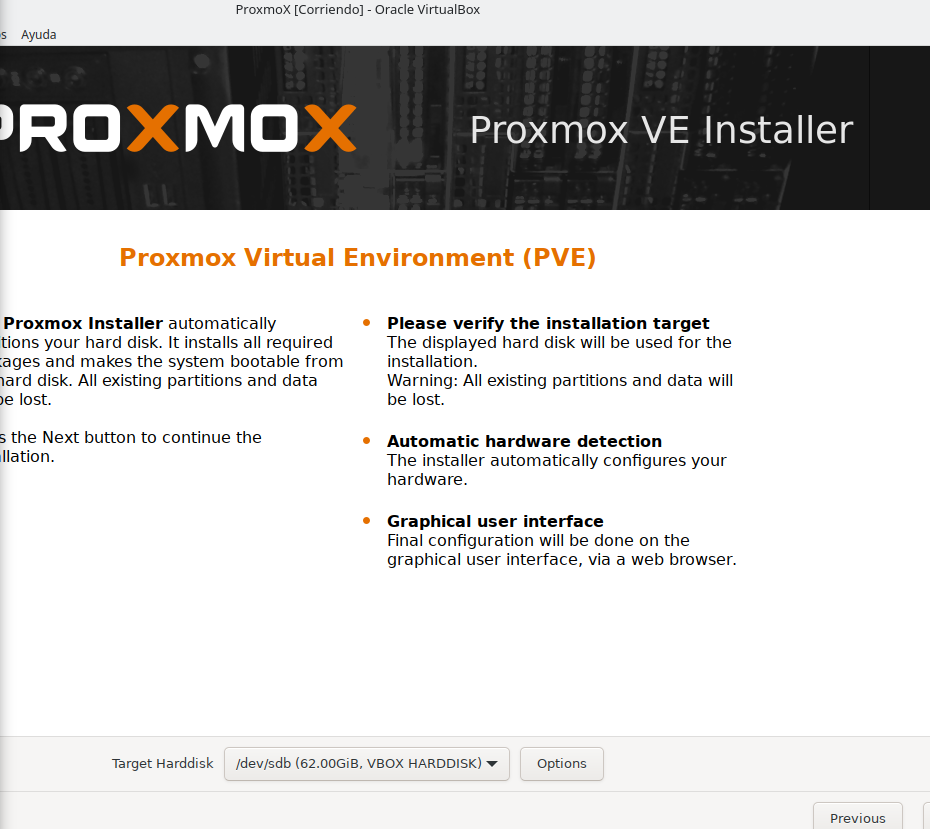

### Evidencia 3-configuracion
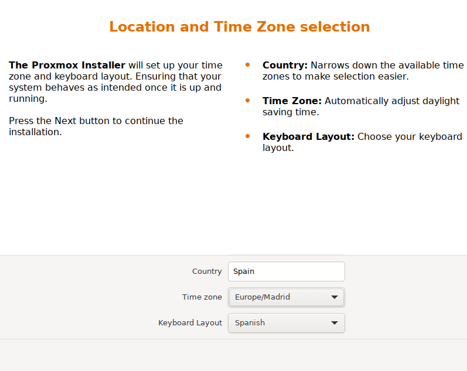
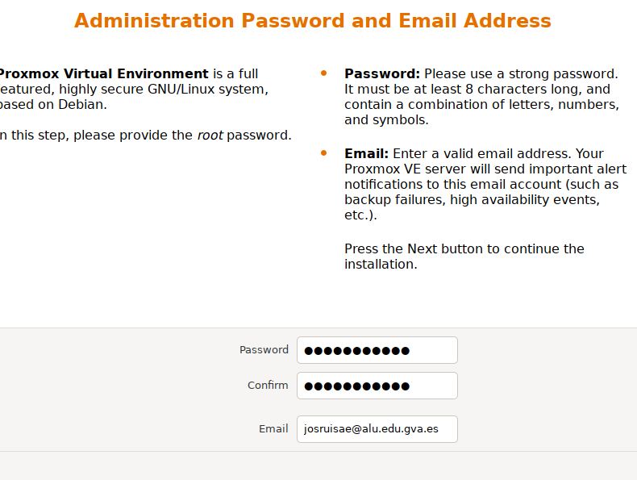

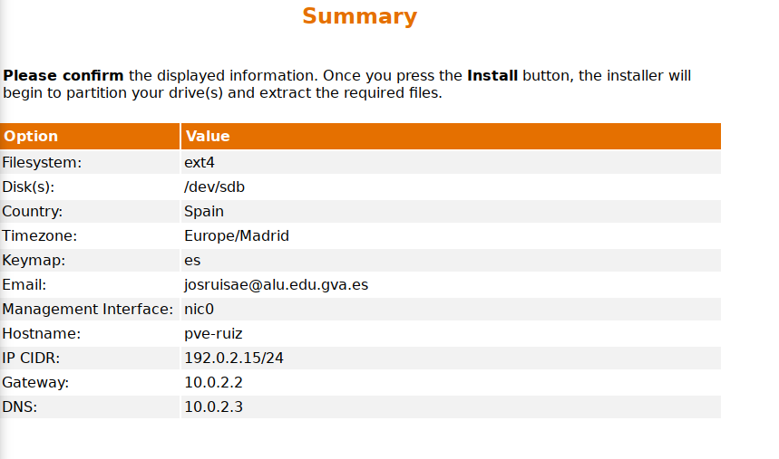

### Evidencia 4-primer arranque
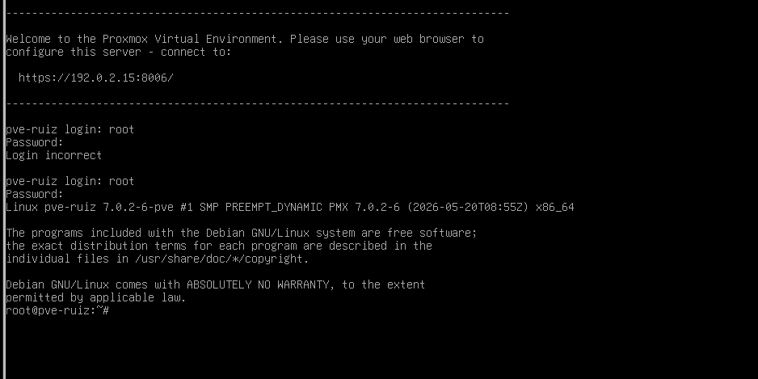

### Evidencia 5-interfaz web
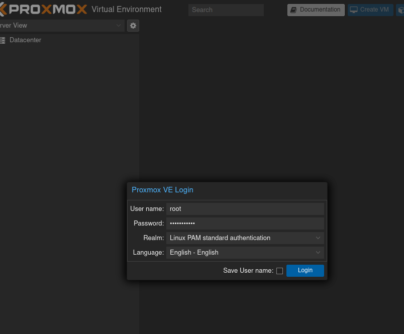
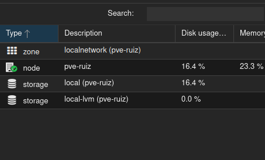

### Comandos
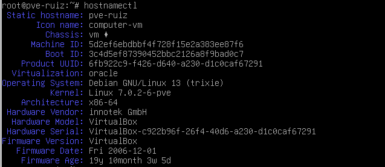
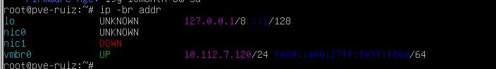
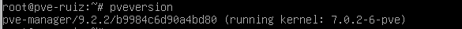
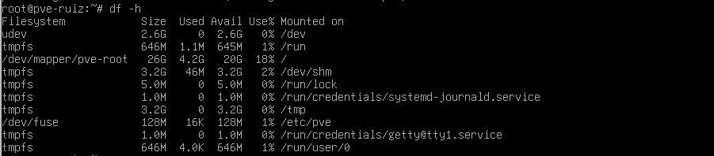

## Incidencias
La unica incidencia ha sido que la pantalla se ponia en negro por no configurar bien la maquina virtual pero ya se ha solucionado

## Conclusion
Esta fase constituye la base para continuar con la configuración de la red, la creación de máquinas virtuales y la instalación de los sistemas operativos que formarán parte del proyecto.
Ademas se ha completado sin mayor problema y funciona correctamente

# 04-Configuración-base-del-nodo

## 1. Revisión de almacenamientos
Se ha revisado el apartado Datacenter -> Storage y se han ejecutado los comandos pvesm status y df -h para comprobar los almacenamientos y el espacio disponible.

El nodo dispone de dos almacenamientos principales:

local: almacenamiento de tipo directorio (dir), con aproximadamente 26,4 GB de capacidad total y 20,7 GB disponibles. Se utiliza para guardar archivos como imágenes ISO, plantillas y copias de seguridad, según los contenidos habilitados.

local-lvm: almacenamiento de tipo LVM-Thin (lvmthin), con aproximadamente 20,7 GB disponibles. Está destinado principalmente a los discos de las máquinas virtuales y contenedores.

Ambos almacenamientos aparecen activos.

También se ha comprobado el espacio de la partición principal mediante df -h. Esta dispone de aproximadamente 26 GB, de los cuales 4,2 GB están ocupados y 20 GB permanecen disponibles.
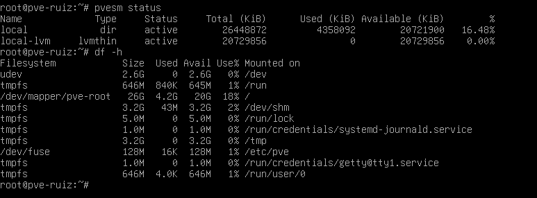

Por último, se han ejecutado free -h y lsblk para revisar la memoria RAM y la distribución de los discos. El nodo dispone de 6,3 GiB de RAM y actualmente tiene aproximadamente 4,8 GiB disponibles.
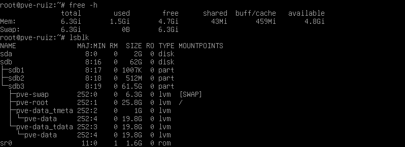

En conclusión, el nodo dispone de almacenamiento y memoria disponibles para continuar con la configuración del laboratorio.


## 2. Revisión de interfaces de red
Se han comprobado las interfaces de red del nodo Proxmox
mediante los comandos `ip -br addr` e `ip route`.

La interfaz principal de gestión es `vmbr0`, que tiene
configurada la dirección IP 10.112.7.120/24.

La puerta de enlace predeterminada es 10.112.7.1.

También se observa que la interfaz `nic1` aparece como
DOWN, mientras que `vmbr0` se encuentra activa (UP).

La configuración permite identificar la interfaz utilizada
para la comunicación y administración del nodo.
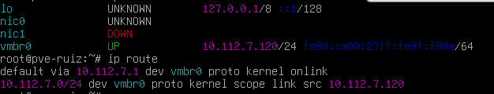

## 3. Usuarios y permisos
Se ha revisado el apartado Datacenter -> Permissions -> Users
de la interfaz web de Proxmox.

Actualmente aparece el usuario `root` con el realm `pam`.
La cuenta está habilitada y no tiene fecha de caducidad.

Este usuario dispone de privilegios administrativos para
gestionar el nodo Proxmox.

No se han creado usuarios adicionales.
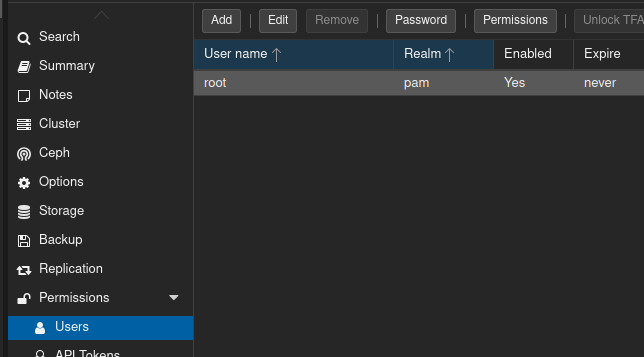

## 4. Comprobación de discos
Se ha utilizado el comando `lsblk` para identificar
los discos disponibles y su distribución en el sistema.


## 5. Reparto de recursos
Se ha revisado el hardware virtual asignado al nodo Proxmox mediante los comandos lscpu, free -h y lsblk.

El nodo dispone de 3 CPU virtuales, aproximadamente 6,3 GiB de memoria RAM y un disco virtual de 62 GB.

Para el laboratorio se plantea realizar un reparto de recursos entre las máquinas virtuales srv-aso y cli-linux, dejando siempre recursos disponibles para que el nodo Proxmox pueda funcionar correctamente.

| Elmento | CPU/vCPU | RAM | Disco o almacenamiento | Motivo del reparto |
|---|---|---|---|---|
| Nodo Proxmox | 3 | 6,3 GiB | 62GB | Administración y funcionamiento del nodo |
| srv-aso | por asginar | por asignar | por asignar | Alojar los servicios del laboratorio |
| cli-linux | por asignar | por asignar | por asignar | Realizar pruebas y conectarse a los servicios |
| Plantillas, ISO, copias y margen | - | - | espacio restante | Guardar archivos y disponer de espacio adicional |

No se pretende utilizar todos los recursos disponibles, ya que es necesario conservar un margen para el funcionamiento del nodo.

Además, al trabajar con VirtualBox, hay que tener en cuenta que el equipo anfitrión también necesita recursos para funcionar correctamente.

## 6. Incidencias y conclusiones

[Volver al indice](../README.md)
