# Evidencias del proyecto

3)
### Evidencia 1-virtualbox

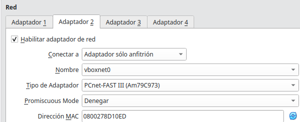
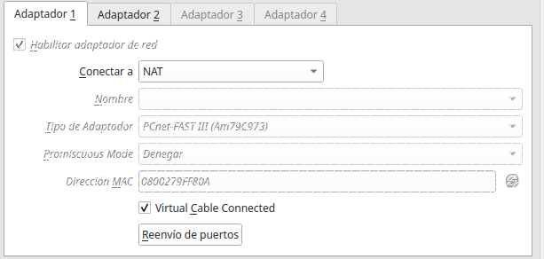
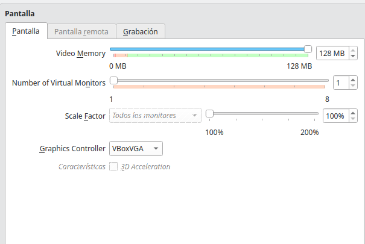
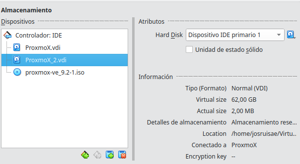
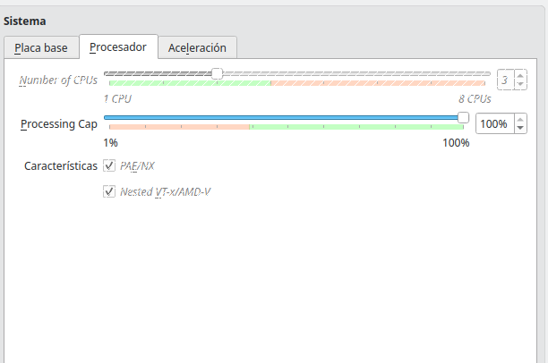

### Evidencia 2-instalador
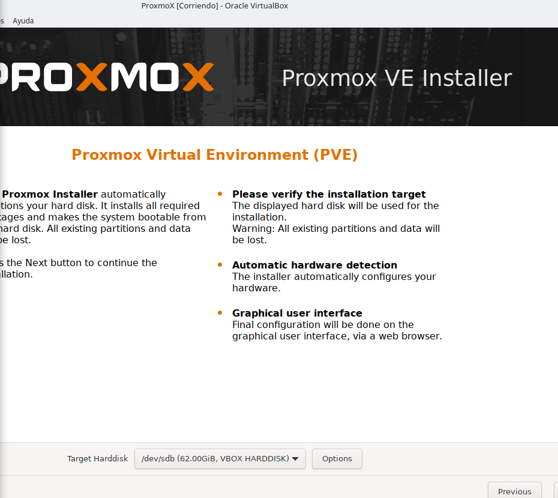

### Evidencia 3-configuracion
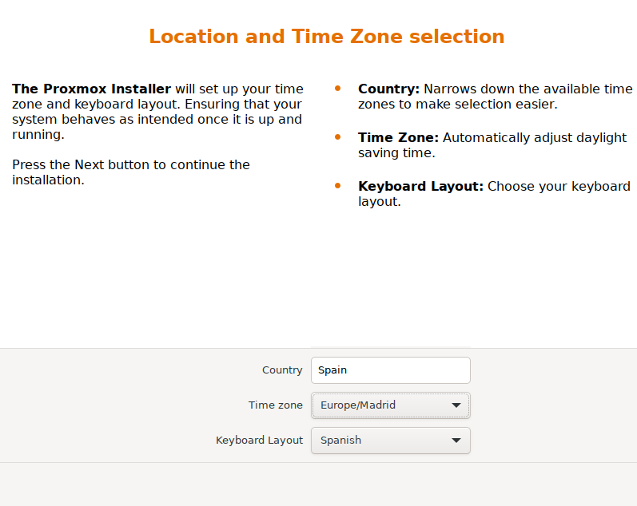


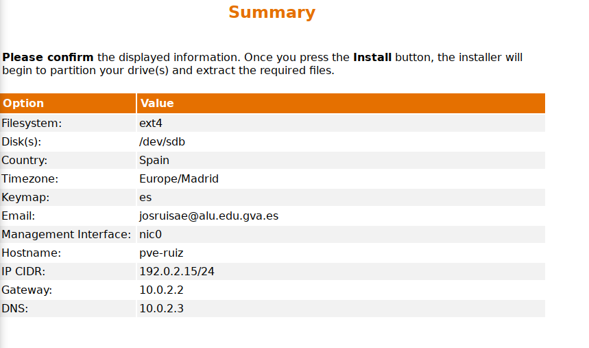

### Evidencia 4-primer arranque
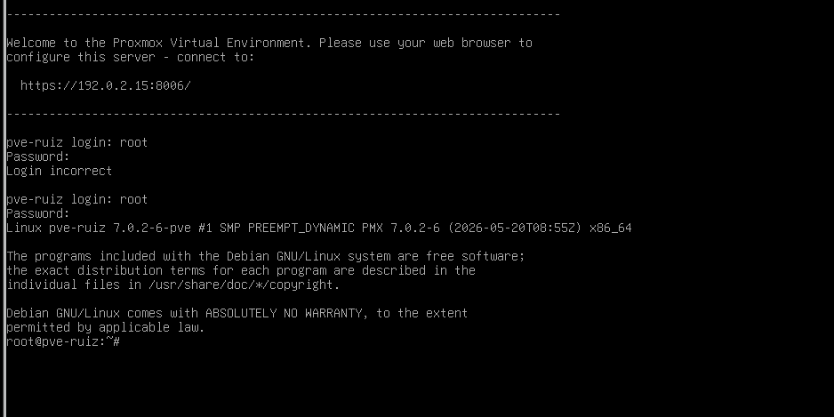

### Evidencia 5-interfaz web
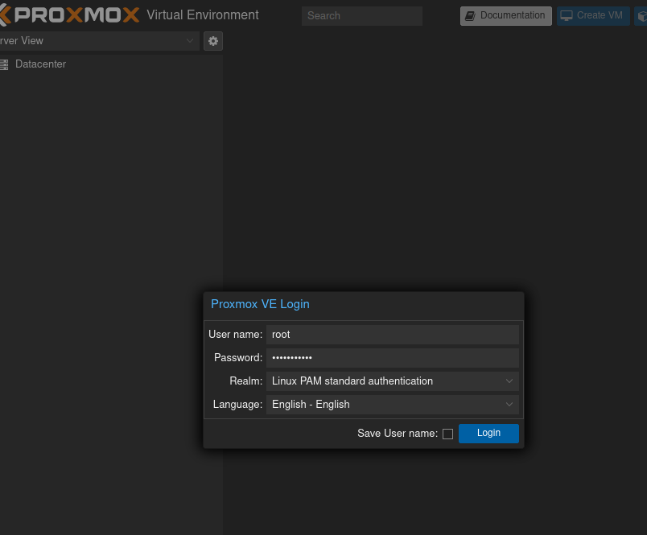
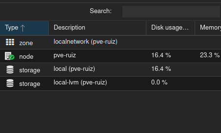

### Comandos
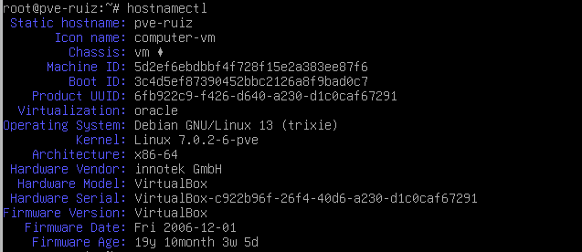
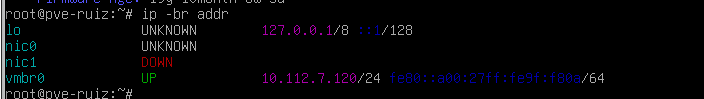
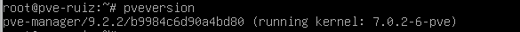
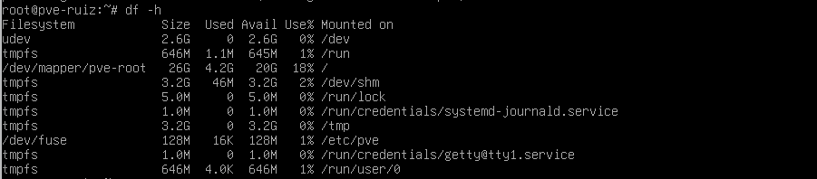

# Proyecto de infraestructura con Proxmox

## Identificación

* **Alumno:** Jose Ruiz
* **Repositorio:** pi-proxmox-jose-ruiz
* **Curso:** 2º ASIR
* **Estado:** Documentación inicial

## Objetivo

El objetivo de este proyecto es diseñar, desplegar, configurar y documentar una infraestructura virtualizada utilizando Proxmox, aplicando los conocimientos adquiridos durante el curso.

## Estado actual

En esta primera fase se ha creado el repositorio y se ha preparado la documentación inicial del proyecto.

La instalación y configuración de Proxmox, así como el inventario del hardware, se realizarán en las siguientes sesiones.

## Modalidad

La modalidad de trabajo y los recursos definitivos están pendientes de confirmar.

## Índice

* [Ficha inicial](docs/00-ficha-inicial.md)
* [Bitácora](docs/00-bitacora.md)
* [Memoria técnica](docs/10-memoria-tecnica.md)
* [Evidencias](evidencias/README.md)

## Comandos utilizados

```bash
git status
git add .
git commit
git push
```


[Volver al indice](../README.md)
